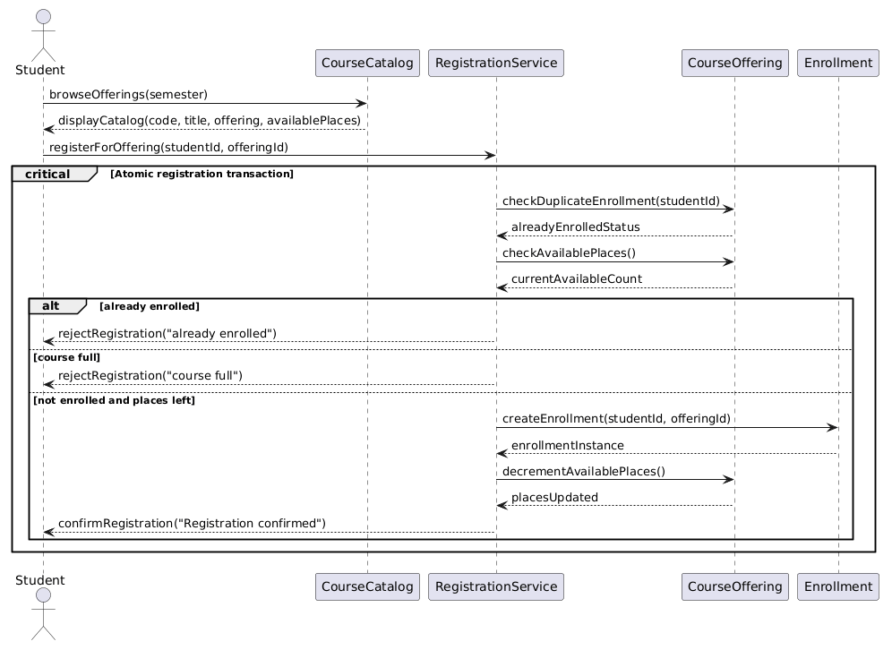
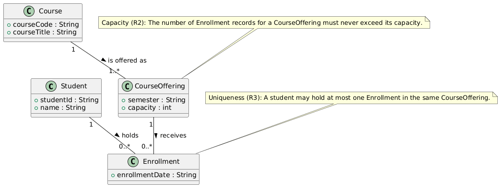
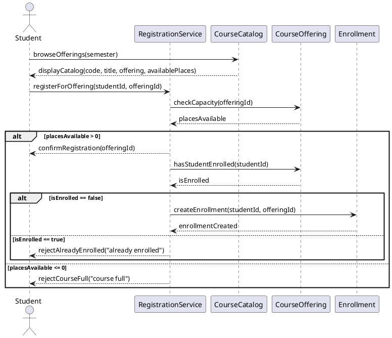
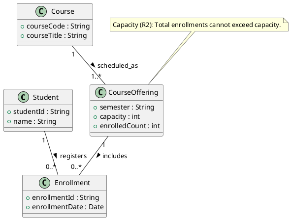
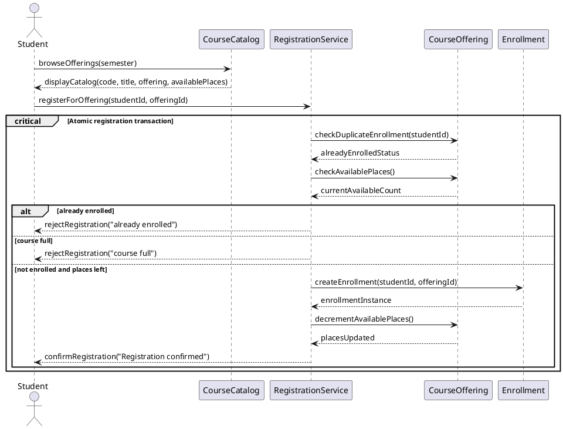
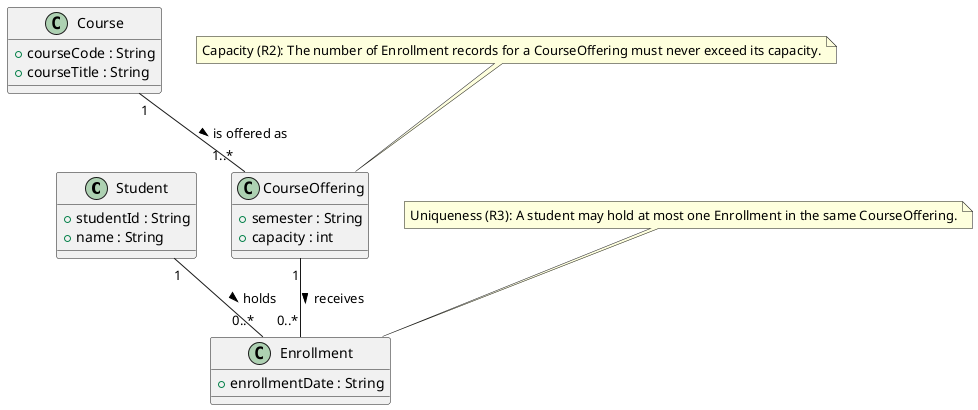
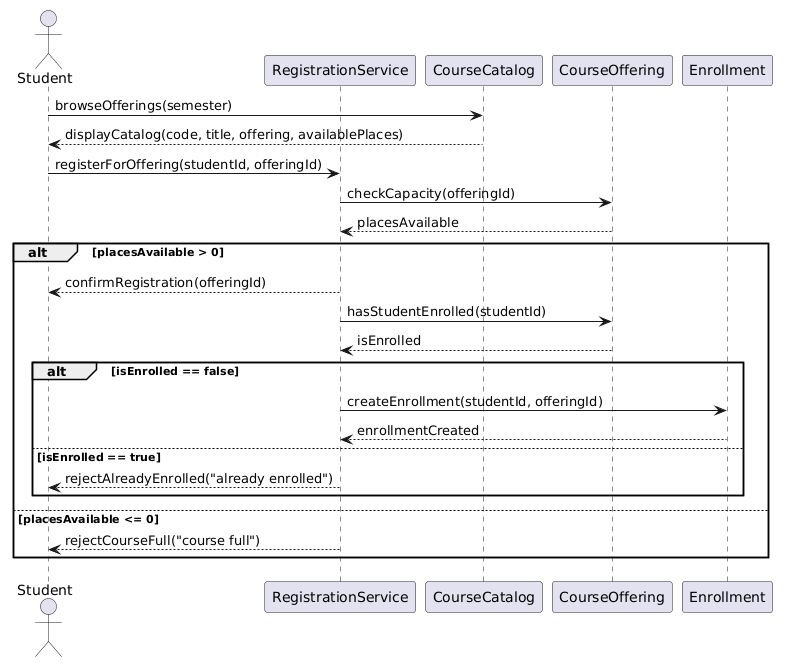
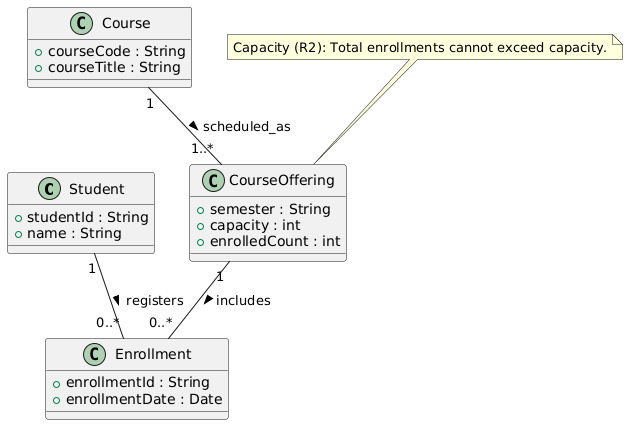

# SIS #02 — AI-Assisted UML Modeling: University Course Registration

## 1. Scope and assumptions

**Scope:** The system provides an automated university course registration workflow allowing an authenticated student to browse course offerings for a single semester and register for a chosen offering with strict capacity enforcement and duplicate prevention. Excluded from this system are payments, prerequisites, timetable clashes, waiting lists, and cancellation.

**Assumptions:**

1. The student is already signed in with a verified student ID, and the selected course offering exists with a positive integer capacity.
2. Viewing available places in the course catalog does not reserve a seat; current capacity and duplicate enrollment must be rechecked atomically during the registration request.
3. If registration fails due to reaching maximum capacity or detecting an existing enrollment, the system rejects the request immediately with an explicit explanatory message, making no modifications to persistent state.

## 2. User stories and acceptance criteria

### US-01 — Browse offerings

**US-01:** As an authenticated student, I want to browse course offerings for a semester, so that I can inspect course details and available places before selecting an offering.

- **AC-01** (R1): Given an authenticated student viewing the course catalog for a semester, When the student requests available offerings, Then the system displays the course code, title, offering identifier, and current available places.
- **AC-02** (R1): Given an offering with a known capacity and enrollment count, When the student views the catalog, Then the system calculates and displays available places as total capacity minus existing enrollments.

### US-02 — Register for an offering

**US-02:** As an authenticated student, I want to register for an offering with available places, so that I can enroll in the section and receive a confirmation.

- **AC-03** (R2, R4): Given an authenticated student not yet enrolled in an offering with at least one place remaining, When the student submits a registration request, Then the system creates exactly one Enrollment linking the student and offering, decrements available places, and returns a confirmation.
- **AC-04** (R2, R4): Given an offering with exactly one place remaining, When a new student requests registration, Then the system creates one Enrollment record, updates available places to zero, and returns a confirmation.

### US-03 — Receive a clear rejection

**US-03:** As an authenticated student submitting a registration request, I want to receive a clear explanation if registration cannot be completed, so that I know why I was not enrolled and the system state remains unchanged.

- **AC-05** (R2, R5): Given an offering whose current enrollment count equals its capacity, When a student submits a registration request, Then the system rejects the request with the message "course full", creates no Enrollment, and leaves the enrollment count unchanged.
- **AC-06** (R3, R5): Given a student who is already enrolled in the selected offering, When the student submits a repeat registration request for that offering, Then the system rejects the request with the message "already enrolled", creates no duplicate record, and leaves the enrollment count unchanged.

## 3. Sequence diagram

**Participants:** Student (actor representing the authenticated university student interacting with the registration portal), CourseCatalog (technical boundary catalog service responsible for querying and displaying courses and offerings), RegistrationService (technical controller service coordinating duplicate checks, capacity validation, and enrollment creation), CourseOffering (domain entity representing the scheduled course section holding capacity and enrollment state), and Enrollment (domain entity representing the confirmed link between a student and an offering).

**Atomic operation:** The critical block containing the messages `checkDuplicateEnrollment(studentId)`, `checkAvailablePlaces()`, `createEnrollment(studentId, offeringId)`, and `decrementAvailablePlaces()` constitutes the single atomic step. A catalog view reserves nothing because seat availability is purely an informational snapshot; concurrent requests could claim the final place between browsing and registration, necessitating an atomic lock during registration.

**Where the Enrollment is created:** The message `createEnrollment(studentId, offeringId)` sent from `RegistrationService` to `Enrollment` instantiates exactly one record of the domain entity `Enrollment` defined in section 4.

**Technical lifelines:** `CourseCatalog` and `RegistrationService`. These lifelines represent application-tier and boundary-tier services coordinating catalog presentation and transactional registration workflows, whereas the class diagram models persistent domain concepts; this difference in abstraction is standard in UML modeling.

## 4. Class diagram

| Association | Read left to right | Read right to left |
| --- | --- | --- |
| Student "1" -- "0..*" Enrollment | A Student holds zero or more Enrollments. | An Enrollment is held by exactly one Student. |
| CourseOffering "1" -- "0..*" Enrollment | A CourseOffering receives zero or more Enrollments. | An Enrollment is linked to exactly one CourseOffering. |
| Course "1" -- "1..*" CourseOffering | A Course is offered as one or more CourseOfferings. | A CourseOffering represents a scheduled section of exactly one Course. |

**How an Enrollment links a student to an offering:** An Enrollment acts as an association entity holding foreign references to exactly one Student and one CourseOffering, capturing the successful registration event along with its timestamp without duplicating student or course attributes.

**Capacity constraint:** Stated in note N1: "The number of Enrollment records for a CourseOffering must never exceed its capacity." Multiplicity `0..*` on Enrollment only denotes that an offering may have zero or many enrollments, but cannot restrict that upper bound to the dynamic numerical value stored in the `capacity` attribute.

**Uniqueness constraint:** Stated in note N2: "A student may hold at most one Enrollment in the same CourseOffering." Multiplicity indicates that a Student can have multiple enrollments across all offerings and an offering can have multiple enrollments across all students, but cannot enforce that the combination of `(Student, CourseOffering)` is unique.

## 5. Traceability

| Rule and criterion | Model evidence | Validation case |
| --- | --- | --- |
| R1 + AC-01, AC-02 | `CourseCatalog.browseOfferings`, `displayCatalog`, Course.courseCode, Course.courseTitle, CourseOffering.semester, CourseOffering.capacity | Static catalog inspection: verified code, title, semester, capacity display |
| R2 + AC-03, AC-04, AC-05 | `RegistrationService.checkAvailablePlaces()`, `[else course full]` guard, note N1 | T1, T2, T3 |
| R3 + AC-06 | `RegistrationService.checkDuplicateEnrollment()`, `[alt already enrolled]` guard, note N2 | T4 |
| R4 + AC-03, AC-04 | `RegistrationService.createEnrollment()`, `confirmRegistration()`, Enrollment class | T1, T2 |
| R5 + AC-05, AC-06 | `rejectRegistration("course full")`, `rejectRegistration("already enrolled")` | T3, T4 |

## 6. Walkthroughs

| Case | Observed path and state change | Judgment and evidence |
| --- | --- | --- |
| T1. Available | Student requests registration; RegistrationService checks duplicates (false) and availability (2 places); enters success branch, creates Enrollment, decrements places; enrollment count changes from 0 to 1; confirmation returned. | Pass: verified at `createEnrollment` and `confirmRegistration` |
| T2. Last place | Student requests registration; RegistrationService checks duplicates (false) and availability (1 place left); enters success branch, creates Enrollment, decrements places to 0; enrollment count changes from 1 to 2; confirmation returned. | Pass: verified at `createEnrollment` and `decrementAvailablePlaces` |
| T3. Full | Student requests registration after stale catalog view; RegistrationService checks duplicates (false) and availability (0 places); enters course full branch; returns rejection "course full"; enrollment count stays 2 with no record created. | Pass: verified at `rejectRegistration("course full")` guard |
| T4. Duplicate | Student requests registration again; RegistrationService executes checkDuplicateEnrollment returning true; enters already enrolled branch; returns rejection "already enrolled"; enrollment count remains unchanged at 1 with no creation. | Pass: verified at `rejectRegistration("already enrolled")` guard |

## 7. Review decisions

| AI suggestion or model element | Decision | Reason | Rule |
| --- | --- | --- | --- |
| Original sequence confirmed registration before verifying duplicate status and creating the Enrollment record | Accepted critique and modified diagram | Confirming enrollment before atomic checks allowed race conditions where rejected students received false confirmation messages | R4 |
| Sequence diagram checked capacity and duplicates outside of an atomic transactional boundary | Accepted critique and wrapped checks in critical block | Without an atomic block, two concurrent students could observe one remaining place and both register simultaneously | R2 |
| Class diagram lacked an explicit uniqueness constraint note on Enrollment | Accepted critique and added constraint note N2 | Multiplicities alone cannot prevent a student from registering multiple times for the exact same course offering section | R3 |

## 8. Modeling explanation

Our UML design prioritizes separation of concerns, data integrity, and deterministic execution of business rules. The class diagram specifies the static domain model of university course registration. The core conceptual distinction separates a Course (a catalog subject) from a CourseOffering (a scheduled semester section with a strict capacity). An Enrollment represents the associative link connecting one student to one offering. Because standard UML multiplicities express cardinalities across instances rather than numerical business boundaries, dedicated constraint notes enforce capacity limits (R2) and uniqueness per student and offering (R3).

The sequence diagram complements the static structure by specifying dynamic interactions across time. It captures the behavioral progression from informational catalog browsing to transactional registration. Crucially, the sequence diagram establishes that catalog data is non-binding. To satisfy concurrency safety, the final duplicate check, available capacity verification, enrollment creation, and seat decrement are grouped inside a critical atomic transaction. This guarantees that competing requests cannot claim the same final seat. Rejection branches for full courses and duplicate registrations return explicit explanations while strictly prohibiting state updates or confirmation messages.

While class and sequence diagrams illustrate static relationships and synchronous object messaging, an activity diagram could significantly enhance process comprehension. Course registration involves complex decision branching, pre-condition evaluations, and concurrency locks that are naturally represented as control and data flows. An activity diagram would visually depict decision diamonds, merge points, and fork-join parallel processing during atomic lock acquisition and exception routing. This behavioral view clarifies end-to-end user navigation and failure handling for software engineers before implementation begins.

## 9. Reflection

Using an AI assistant accelerated the initial drafting of acceptance criteria and structural PlantUML templates, providing a clean syntactic starting point. However, the assistant's initial sequence diagram contained a critical architectural defect: it sent a registration confirmation to the student prior to checking duplicate status and persisting the record. I identified this flaw myself during model review and corrected it by moving confirmation strictly after atomic creation within the guarded success branch.

Furthermore, the initial AI class diagram relied solely on associations without expressing business invariants. I made the conscious decision to introduce separate UML constraint notes for capacity and uniqueness, recognizing that standard multiplicities cannot enforce dynamic limits. A remaining limitation of the current design is that while the atomic transaction note prevents concurrent oversubscription conceptually, it abstracts away database-level concurrency mechanisms such as optimistic locking or distributed mutexes. In a production environment, database deadlocks and high contention on popular course sections would require explicit retry policies and transaction isolation specifications.

## 10. Appendix A — Before AI

**Scope:** The system enables an authenticated student to browse course offerings for a specific semester and register for an offering with real-time capacity and duplicate checks, while explicitly excluding payments, prerequisites, timetable clashes, waiting lists, and cancellation.

**Initial assumptions:**

1. The student is authenticated with an existing student identifier prior to browsing and requesting registration.
2. Each course offering possesses a positive whole number capacity for a single semester and exists in the catalog.
3. Catalog browsing provides a non-binding snapshot of availability; final enrollment checks and seat allocation must occur atomically during registration.

## 11. Appendix B — AI exchanges

### B1 — Requirements (Prompt A)

- **Tool:** Antigravity
- **Model:** Gemini 3.8 Flash
- **Date:** 2026-10-18
- **Purpose:** draft 3 user stories and 6 acceptance criteria

**Prompt:**

~~~~text
Act as a requirements analyst. Use only this course registration scenario and rules R1–R5: A student browses an electronic course catalog, chooses a course offering and requests registration. Each offering has a limited number of places. A Course describes a subject. A CourseOffering is one scheduled section in one semester. Registration always targets a specific offering. Assume that the student is signed in, the selected offering exists, and its capacity is a positive whole number. Exclude payments, prerequisites, timetable clashes, waiting lists and cancellation. Use fictional students and courses. R1. Catalog: Show the course code, title, offering and available places for one semester. R2. Capacity: Recheck current availability when registering. Enrollment must never exceed the offering's capacity. R3. Duplicates: A student may have at most one enrollment in the same offering. Reject a repeat request. R4. Success: Create exactly one Enrollment linking the student and offering, update availability and return a confirmation. R5. Rejection: Explain "course full" or "already enrolled". Create no enrollment and leave the enrollment count unchanged. My initial assumptions are: 1. The student is authenticated with an existing student identifier prior to browsing and requesting registration. 2. Each course offering possesses a positive whole number capacity for a single semester and exists in the catalog. 3. Catalog browsing provides a non-binding snapshot of availability; final enrollment checks and seat allocation must occur atomically during registration.
Draft 3 user stories and 2 Given / When / Then acceptance criteria for each. Use IDs US-01 to US-03 and AC-01 to AC-06. Map each criterion to rule IDs.
Cover normal and rejection behavior. List uncertainty separately. Do not add excluded features or invent university policies.
~~~~

**Response:**

~~~~text
### User Stories and Acceptance Criteria

#### US-01 — Browse offerings
**US-01:** As an authenticated student, I want to browse available course offerings for the current semester, so that I can view available seats and decide which section to select for registration.

- **AC-01** (R1): Given an authenticated student accessing the course catalog for a designated semester, When the student requests the list of offerings, Then the system displays the course code, course title, offering section identifier, and the current number of available places for each offering.
- **AC-02** (R1): Given a course offering with a capacity of 30 and 12 existing enrollments, When the student views that offering in the catalog, Then the system displays exactly 18 available places along with the course code and title.

#### US-02 — Register for an offering
**US-02:** As an authenticated student, I want to register for a specific course offering that has open capacity, so that I secure my enrollment and receive a confirmation.

- **AC-03** (R2, R4): Given an authenticated student who is not enrolled in course offering "CS101-A", and the offering currently has at least one available place, When the student submits a registration request for "CS101-A", Then the system verifies available capacity, creates exactly one Enrollment record linking the student and offering, decrements the available places by one, and returns a registration confirmation.
- **AC-04** (R2, R4): Given a course offering with capacity 2 and currently 1 enrolled student, When a second eligible student requests registration, Then the system rechecks availability, creates exactly one Enrollment record, updates the available count to 0, and returns a successful confirmation.

#### US-03 — Receive a clear rejection
**US-03:** As an authenticated student submitting a registration request, I want to receive an explicit explanation if registration cannot be completed, so that I understand why the request failed without any invalid records being created.

- **AC-05** (R2, R5): Given a course offering whose current enrollment count equals its capacity (0 available places), When a student attempts to register for that offering, Then the system rejects the registration with the explicit reason "course full", creates no Enrollment record, and leaves the enrollment count unchanged.
- **AC-06** (R3, R5): Given an authenticated student who already holds an active enrollment in course offering "CS101-A", When the same student submits another registration request for "CS101-A", Then the system rejects the request with the explicit reason "already enrolled", creates no duplicate Enrollment record, and leaves the enrollment count unchanged.

### Uncertainty & Technical Considerations
- Catalog data is non-binding: between viewing catalog availability and completing registration, concurrent requests may consume the remaining places. The final capacity and duplicate checks must be executed atomically.
- Scope boundaries respected: payments, prerequisites, timetable clashes, waiting lists, and cancellation policies are excluded.
~~~~

### B2 — UML drafts (Prompt B)

- **Tool:** Antigravity
- **Model:** Gemini 3.8 Flash
- **Date:** 2026-10-18
- **Purpose:** draft the sequence and class diagrams

**Prompt:**

~~~~text
Using my approved scenario, R1–R5, stories and criteria below, return separate PlantUML code blocks for a sequence diagram and a domain class diagram.
Sequence: include catalog browsing and guarded success, full-course and duplicate outcomes. Model final checks and creation as one atomic operation.
Class: show domain concepts, useful attributes and multiplicities. State the capacity and uniqueness constraints. Explain assumptions and any technical lifelines.

Approved requirements:
Scenario: A student browses an electronic course catalog, chooses a course offering and requests registration. Each offering has a limited number of places. A Course describes a subject. A CourseOffering is one scheduled section in one semester. Registration always targets a specific offering. Assume that the student is signed in, the selected offering exists, and its capacity is a positive whole number. Exclude payments, prerequisites, timetable clashes, waiting lists and cancellation. Use fictional students and courses.
Rules: R1, R2, R3, R4, R5.

### US-01 — Browse offerings
**US-01:** As an authenticated student, I want to browse course offerings for a semester, so that I can inspect course details and available places before selecting an offering.
- **AC-01** (R1): Given an authenticated student viewing the course catalog for a semester, When the student requests available offerings, Then the system displays the course code, title, offering identifier, and current available places.
- **AC-02** (R1): Given an offering with a known capacity and enrollment count, When the student views the catalog, Then the system calculates and displays available places as total capacity minus existing enrollments.

### US-02 — Register for an offering
**US-02:** As an authenticated student, I want to register for an offering with available places, so that I can enroll in the section and receive a confirmation.
- **AC-03** (R2, R4): Given an authenticated student not yet enrolled in an offering with at least one place remaining, When the student submits a registration request, Then the system creates exactly one Enrollment linking the student and offering, decrements available places, and returns a confirmation.
- **AC-04** (R2, R4): Given an offering with exactly one place remaining, When a new student requests registration, Then the system creates one Enrollment record, updates available places to zero, and returns a confirmation.

### US-03 — Receive a clear rejection
**US-03:** As an authenticated student submitting a registration request, I want to receive a clear explanation if registration cannot be completed, so that I know why I was not enrolled and the system state remains unchanged.
- **AC-05** (R2, R5): Given an offering whose current enrollment count equals its capacity, When a student submits a registration request, Then the system rejects the request with the message "course full", creates no Enrollment, and leaves the enrollment count unchanged.
- **AC-06** (R3, R5): Given a student who is already enrolled in the selected offering, When the student submits a repeat registration request for that offering, Then the system rejects the request with the message "already enrolled", creates no duplicate record, and leaves the enrollment count unchanged.
~~~~

**Response:**

~~~~text
Here are the initial drafts for the sequence diagram and domain class diagram based on your approved specifications.

### Sequence Diagram

### Class Diagram

### Notes & Assumptions
- Technical lifelines `CourseCatalog` and `RegistrationService` manage boundary catalog retrieval and business coordination.
- `Student`, `Course`, `CourseOffering`, and `Enrollment` constitute the core persistent domain entities.
~~~~

### B3 — Model critique (Prompt C)

- **Tool:** Antigravity
- **Model:** Gemini 3.8 Flash
- **Date:** 2026-10-18
- **Purpose:** review both models against R1–R5 and T1–T4

**Prompt:**

~~~~text
Review these two UML models against R1–R5 and my acceptance criteria. Check message order, guards, state changes, multiplicities and naming.
Inspect the four validation cases: available places, exactly one place, full course after a stale catalog view, and duplicate registration.
For each issue, cite the affected rule and model element. Explain the impact and propose a focused correction. Separate genuine defects from optional design choices.

Approved acceptance criteria:
- AC-01 (R1): Catalog displays code, title, offering, available places.
- AC-02 (R1): Available places calculated as capacity minus enrollments.
- AC-03 (R2, R4): Student registers with open places, creates Enrollment, decrements places, confirms.
- AC-04 (R2, R4): Last place registration creates Enrollment, decrements to 0, confirms.
- AC-05 (R2, R5): Full course rejected with "course full", no Enrollment created.
- AC-06 (R3, R5): Duplicate registration rejected with "already enrolled", no Enrollment created.

Models to review:

~~~~

**Response:**

~~~~text
### Review and Critique of UML Models

#### Genuine Defects

1. **Premature Confirmation Message (Rule R4):**
   - *Affected element:* Sequence diagram line 16 (`confirmRegistration(offeringId)`).
   - *Issue:* In the draft sequence diagram, `confirmRegistration` is sent to the student *before* verifying if the student is already enrolled and *before* creating the `Enrollment` record.
   - *Impact:* In test case T4 (duplicate registration), a student would receive a confirmation followed immediately by a rejection `already enrolled`. This violates rule R4 ("return a confirmation upon successful creation").
   - *Correction:* Move `confirmRegistration` to the end of the success branch, strictly after `createEnrollment`.

2. **Lack of Explicit Concurrency Boundary / Atomicity (Rule R2):**
   - *Affected element:* Sequence diagram checks and enrollment creation.
   - *Issue:* The diagram performs separate checks for capacity and duplicate status without an enclosing atomic block or transaction note.
   - *Impact:* In concurrent execution scenarios (such as two students attempting to claim the last available place in T2/T3), both requests could pass `checkCapacity` before either creates an enrollment, leading to oversubscription.
   - *Correction:* Enclose the duplicate check, capacity verification, enrollment creation, and availability decrement inside a UML `critical` group labeled "Atomic registration transaction".

3. **Missing Uniqueness Constraint Note (Rule R3):**
   - *Affected element:* Class diagram notes.
   - *Issue:* While the capacity constraint note N1 is present, there is no note defining the uniqueness constraint.
   - *Impact:* Multiplicities `Student "1" -- "0..*" Enrollment` and `CourseOffering "1" -- "0..*" Enrollment` permit a student to have multiple enrollments in the same offering. UML multiplicity alone cannot enforce composite key uniqueness.
   - *Correction:* Add a second note N2: `note "Uniqueness (R3): A student may hold at most one Enrollment in the same CourseOffering." as N2` linked to `Enrollment`.

#### Optional Design Considerations
- The order of checks: checking duplicate enrollment before available capacity is generally preferred in user experience so that an already registered student receives "already enrolled" even if the section happens to be full.
- Guard naming: Ensure alt guards use clear syntax without square brackets in the PlantUML source (`alt already enrolled`, `else course full`, `else not enrolled and places left`) so PlantUML renders standard UML bracketed guards cleanly.
~~~~

### B4 — Focused revision (Prompt D)

- **Tool:** Antigravity
- **Model:** Gemini 3.8 Flash
- **Date:** 2026-10-18
- **Purpose:** apply my accepted review decisions

**Prompt:**

~~~~text
Revise the UML sources using only my accepted review decisions: 1. Move confirmation after successful enrollment creation in the success branch (R4). 2. Enclose duplicate check, capacity check, and enrollment creation within a UML critical block representing an atomic transaction (R2). 3. Add explicit uniqueness constraint note N2 on Enrollment in the class diagram (R3). Keep justified existing elements and explain each change.
Preserve the agreed scope and rule IDs. Return both updated PlantUML blocks and a concise change log. Flag any unresolved issue.
Approved requirements:
Scenario: A student browses an electronic course catalog, chooses a course offering and requests registration. Each offering has a limited number of places. A Course describes a subject. A CourseOffering is one scheduled section in one semester. Registration always targets a specific offering. Assume that the student is signed in, the selected offering exists, and its capacity is a positive whole number. Exclude payments, prerequisites, timetable clashes, waiting lists and cancellation. Use fictional students and courses.
Rules: R1, R2, R3, R4, R5.
Stories: US-01, US-02, US-03. Criteria: AC-01, AC-02, AC-03, AC-04, AC-05, AC-06.

Original sources:

My review decisions and evidence:
1. Reordered sequence: check duplicate enrollment first, check available capacity second, and place confirmation strictly after enrollment creation.
2. Encapsulated all registration verification and state updates in a critical atomic transaction block.
3. Added constraint note N2 to class diagram specifying uniqueness of (student, offering).
~~~~

**Response:**

~~~~text
### Updated UML Models

#### Sequence Diagram

#### Class Diagram

### Change Log
- **Sequence Diagram:** Wrapped registration checks and enrollment creation within a UML `critical` block labeled "Atomic registration transaction". Reordered checks to verify duplicate enrollment before capacity, and moved `confirmRegistration` after `createEnrollment` and `decrementAvailablePlaces` strictly on the success path. Rejection paths return reasons ("already enrolled", "course full") without state changes or confirmations.
- **Class Diagram:** Added note N2 attached to `Enrollment` defining the uniqueness constraint (R3). Standardized association read labels and attributes.
- **Unresolved issues:** None. Both models satisfy all constraints R1–R5 and validation cases T1–T4.
~~~~

## 12. Appendix C — Original diagrams

## 13. Appendix D — References and source checks

### References

- Sommerville, I. (2016). Software Engineering, 10th ed., Global Edition. Pearson. Chapter 5.
- Fowler, M. (2004). UML Distilled: A Brief Guide to the Standard Object Modeling Language, 3rd ed. Addison-Wesley.
- PlantUML Language Reference Guide. Sequence Diagram and Critical Groups. https://plantuml.com/sequence-diagram (accessed 2026-10-18).

### Source checks

| Modeling decision | Source and locator | What the source says | How it supports or changed your model |
| --- | --- | --- | --- |
| Modeling capacity and uniqueness as explicit UML constraint notes attached to classes rather than multiplicities | Sommerville, I. (2016). Software Engineering, 10th ed. Pearson. Chapter 5, Section 5.1, pp. 144–146. | Class diagrams model static object structures, but specific domain business rules and dynamic integrity constraints require annotations or formal constraint expressions. | Supported separating structural associations from dynamic capacity (R2) and duplicate prevention (R3) using explicit UML constraint notes N1 and N2. |
| Enclosing registration checks and creation in an atomic critical sequence block | PlantUML Reference Guide: https://plantuml.com/sequence-diagram (accessed 2026-10-18) | The critical group in UML sequence diagrams represents an atomic block of messages where execution must not be interleaved with competing interactions. | Changed the model from loose sequential messages to a strict critical block ensuring concurrency safety during capacity and duplicate evaluation. |
